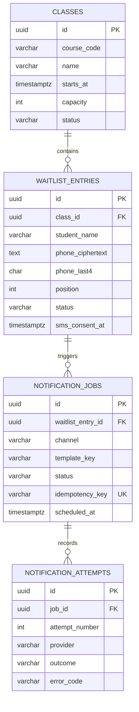

# Database Schema / ERD

## Proposed entities

### `classes`
| Field | Type | Rules |
|---|---|---|
| `id` | UUID | Primary key |
| `course_code` | VARCHAR(32) | Required, indexed |
| `name` | VARCHAR(160) | Required |
| `starts_at` | TIMESTAMPTZ | Required |
| `capacity` | INTEGER | Required, greater than 0 |
| `status` | VARCHAR(16) | `scheduled`, `in_progress`, `completed`, `cancelled` |
| `created_at` | TIMESTAMPTZ | Required |
| `updated_at` | TIMESTAMPTZ | Required |

### `waitlist_entries`
| Field | Type | Rules |
|---|---|---|
| `id` | UUID | Primary key |
| `class_id` | UUID | FK → `classes.id`, indexed |
| `student_name` | VARCHAR(120) | Required; trimmed and length-limited |
| `phone_ciphertext` | TEXT | Required; encrypted at rest in production |
| `phone_last4` | CHAR(4) | Optional display aid |
| `position` | INTEGER | Required, positive |
| `status` | VARCHAR(20) | `waiting`, `notified`, `accepted`, `declined`, `expired`, `removed` |
| `sms_consent_at` | TIMESTAMPTZ | Nullable; dispatch prohibited when null |
| `created_at` | TIMESTAMPTZ | Required |
| `updated_at` | TIMESTAMPTZ | Required |

### `notification_jobs`
| Field | Type | Rules |
|---|---|---|
| `id` | UUID | Primary key |
| `waitlist_entry_id` | UUID | FK → `waitlist_entries.id`, indexed |
| `channel` | VARCHAR(12) | `sms` |
| `template_key` | VARCHAR(64) | Required; allow-listed template |
| `status` | VARCHAR(16) | `queued`, `processing`, `sent_mock`, `failed`, `cancelled` |
| `idempotency_key` | VARCHAR(128) | Required, unique |
| `scheduled_at` | TIMESTAMPTZ | Required |
| `processed_at` | TIMESTAMPTZ | Nullable |
| `created_at` | TIMESTAMPTZ | Required |

### `notification_attempts`
| Field | Type | Rules |
|---|---|---|
| `id` | UUID | Primary key |
| `job_id` | UUID | FK → `notification_jobs.id`, indexed |
| `attempt_number` | INTEGER | Positive; unique with `job_id` |
| `provider` | VARCHAR(32) | `twilio_mock` |
| `provider_reference` | VARCHAR(128) | Nullable; mock reference only |
| `outcome` | VARCHAR(16) | `success_mock`, `retryable_error`, `permanent_error` |
| `error_code` | VARCHAR(64) | Nullable; no raw secrets/PII |
| `created_at` | TIMESTAMPTZ | Required |

## Mermaid ERD

## Constraints and indexes
- Enforce unique active queue positions per class; reposition transactionally.
- Unique `notification_jobs.idempotency_key`.
- Unique `notification_attempts(job_id, attempt_number)`.
- Index `classes(status, starts_at)`, `waitlist_entries(class_id, status, position)`, and `notification_jobs(status, scheduled_at)`.
- Use restrictive deletion for audit-bearing records; prefer status changes/soft removal.
- Store timestamps in UTC and define a retention/deletion policy for personal data.
- Never log full phone numbers, personal message bodies, credentials or raw provider payloads.

## Lifecycle
Waitlist: `waiting → notified → accepted | declined | expired`; staff may set `removed`.  
Job: `queued → processing → sent_mock` or `failed`. Retryable failures create a new attempt under the same job, subject to a bounded retry policy.
